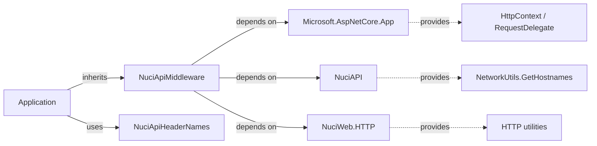
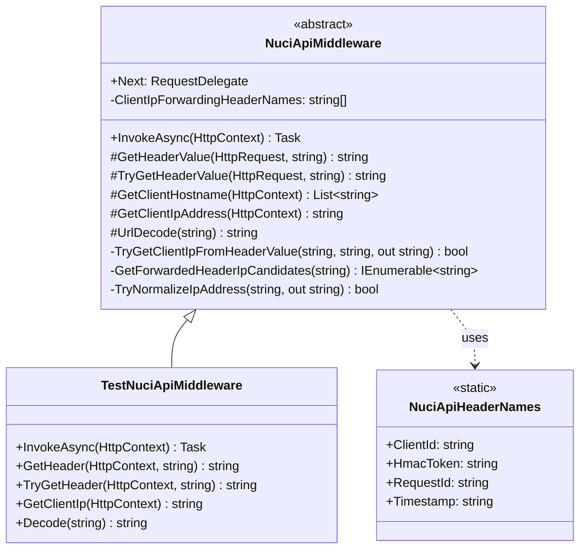
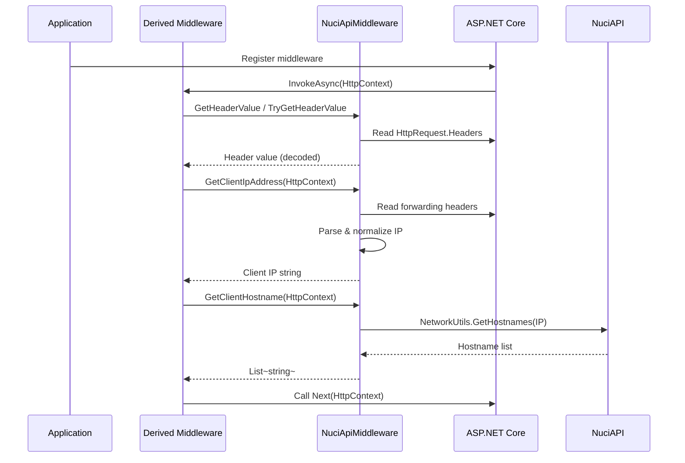
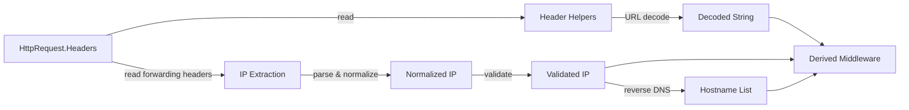
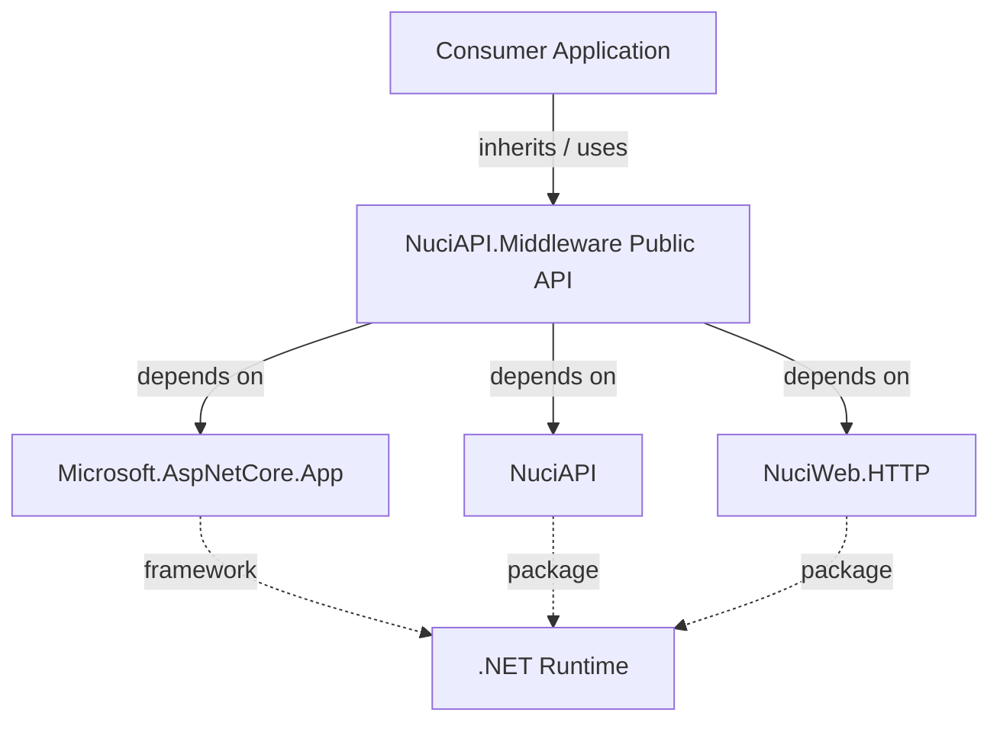

# NuciAPI.Middleware Architecture

This document describes the current architecture of the NuciAPI.Middleware library, an ASP.NET Core middleware base utilities package targeting .NET 10.0. It covers the library's public contracts, internal modules, dependency direction, and extension points.

## 📑 Table of Contents

- [Purpose](#-purpose)
- [System Context](#-system-context)
- [Architectural Style](#-architectural-style)
- [Runtime Flow](#-runtime-flow)
- [Components](#-components)
- [Data Architecture](#-data-architecture)
- [Interfaces and Integrations](#-interfaces-and-integrations)
- [Cross-Cutting Concerns](#-cross-cutting-concerns)
- [Dependency Direction and Rules](#-dependency-direction-and-rules)
- [External Dependencies](#-external-dependencies)
- [Deployment and Operations](#-deployment-and-operations)
- [Compatibility Contracts](#-compatibility-contracts)
- [Testing and Verification](#-testing-and-verification)
- [Design Constraints](#-design-constraints)
- [Extension Points](#-extension-points)
- [Source Map](#-source-map)
- [Related Documentation](#-related-documentation)

## 🎯 Purpose

NuciAPI.Middleware provides an abstract base class and shared header constants for building custom ASP.NET Core middleware in NuciAPI-based services. The library does not operate as a service and does not contain ready-to-register middleware components. Its principal responsibility is to supply reusable infrastructure for header access, client IP extraction from forwarding headers, and URL decoding. The intended audience is library authors and application developers building middleware pipelines. This document records the current architecture to clarify ownership boundaries, dependency rules, and extension contracts.

## 🌐 System Context

NuciAPI.Middleware is a NuGet library consumed by ASP.NET Core applications. The system boundary is the `NuciAPI.Middleware` assembly. Initiating actors are application developers who inherit from `NuciApiMiddleware` and register their derived middleware in the ASP.NET Core pipeline. External systems include the ASP.NET Core hosting layer (`Microsoft.AspNetCore.App`), the NuciAPI package for shared HTTP utilities, and NuciWeb.HTTP for network utilities. The library has no persistent stores and produces no direct outputs; it provides building blocks that applications compose into request pipelines.



The principal external boundaries are:
- **ASP.NET Core Hosting:** Supplies `HttpContext`, `RequestDelegate`, `HttpRequest`, `HttpResponse`, and `BadHttpRequestException`. Owned by the application host.
- **NuciAPI:** Supplies `NetworkUtils.GetHostnames` for reverse DNS lookup from client IP. Owned by the NuciAPI package.
- **NuciWeb.HTTP:** Supplies HTTP-related utilities. Owned by the NuciWeb.HTTP package.

## 🏗️ Architectural Style

The library follows a **library/SDK** architectural style: a single assembly exposing a minimal public surface (one abstract base class and one static header constants class) with internal implementation details. The style consequences are:
- **Ownership:** The library owns the base class implementation and header name constants. Consumers own derived middleware implementations.
- **Change:** Public API changes require version bumps. Internal helpers (`GetClientIpAddress`, `UrlDecode`, header parsing) can evolve without breaking consumers if signatures are preserved.
- **Extensibility:** Consumers extend by inheriting `NuciApiMiddleware` and overriding `InvokeAsync`. The base class protects its constructor and internal helpers.



The principal architecture boundaries are:
- **Public API Surface:** `NuciApiMiddleware` (abstract base), `NuciApiHeaderNames` (constants). Permitted dependencies: consumers may depend on these.
- **Internal Implementation:** IP parsing, header normalization, URL decoding. Prohibited dependencies: consumers must not depend on private/internal members.

## 🔄 Runtime Flow

The library has no independent runtime; it executes within the ASP.NET Core request pipeline. The principal execution path when a derived middleware is invoked:



The principal runtime sequence is:
1. ASP.NET Core invokes the derived middleware's `InvokeAsync` with `HttpContext`.
2. Derived middleware calls base helpers to read required/optional headers (`GetHeaderValue`, `TryGetHeaderValue`).
3. Derived middleware calls `GetClientIpAddress` to extract client IP from forwarding headers or connection.
4. Derived middleware optionally calls `GetClientHostname` for reverse DNS lookup.
5. Derived middleware executes its logic and calls `Next(context)` to continue the pipeline.

## 🧩 Components

| Component | Responsibility | Principal Dependencies | Lifetime or Ownership |
|-----------|----------------|------------------------|-----------------------|
| `NuciApiMiddleware` | Abstract base class providing header access, IP extraction, URL decoding, and hostname resolution helpers | `Microsoft.AspNetCore.Http` (RequestDelegate, HttpContext, BadHttpRequestException), `NuciAPI` (NetworkUtils), `NuciWeb.HTTP` | Singleton per request pipeline; owned by library |
| `NuciApiHeaderNames` | Static constants for standard header names used by NuciAPI-based services | None | Static; owned by library |

## 💾 Data Architecture

The library does not own, persist, or cache meaningful state. It transforms header data in-flight:
- **Header Values:** Read from `HttpRequest.Headers`, URL-decoded via `Uri.UnescapeDataString`, returned as strings. No retention.
- **Client IP:** Extracted from forwarding headers (`X-Forwarded-For`, `Forwarded`, `X-Real-IP`, `CF-Connecting-IP`, `True-Client-IP`), normalized (IPv6 bracket removal, port stripping, "unknown" filtering), validated via `IPAddress.TryParse`. Falls back to `HttpContext.Connection.RemoteIpAddress`. No retention.
- **Hostnames:** Resolved via `NetworkUtils.GetHostnames(IP)` from NuciAPI on demand. No caching.



| Data or Store | Owner | Representation and Storage | Lifecycle or Consistency |
|---------------|-------|----------------------------|--------------------------|
| Header values | ASP.NET Core request | String dictionary in `HttpRequest.Headers` | Per-request, read-only |
| Client IP | ASP.NET Core connection / forwarding headers | String (normalized IPv4/IPv6) | Per-request, derived |
| Hostnames | NuciAPI.NetworkUtils | `List<string>` | Per-request, on-demand |

## 🔌 Interfaces and Integrations

| Interface or Integration | Direction | Contract | Owner | Failure Semantics |
|--------------------------|-----------|----------|-------|-------------------|
| `NuciApiMiddleware` base class | Inbound (inheritance) | Abstract `InvokeAsync(HttpContext)`; protected helpers for headers, IP, hostnames | Library | Missing required header → `BadHttpRequestException`; invalid IP → fallback to connection IP; DNS failure → empty list |
| `NuciApiHeaderNames` constants | Inbound (reference) | Four `string` constants: `ClientId`, `HmacToken`, `RequestId`, `Timestamp` | Library | None (constants) |
| ASP.NET Core `RequestDelegate` | Outbound | `Task InvokeAsync(HttpContext)` | Application host | Pipeline termination if not called |
| `NetworkUtils.GetHostnames` | Outbound | `List<string> GetHostnames(string ip)` | NuciAPI | Returns empty list on failure |

## 🧵 Cross-Cutting Concerns

### Security and Privacy

The library processes header data and client IP addresses provided by the HTTP request. It does not authenticate, authorize, or validate trust boundaries. Trust decisions (which forwarding headers to accept) are delegated to the application via the hardcoded `ClientIpForwardingHeaderNames` array. The library performs no secret handling. Applications must configure ASP.NET Core's `ForwardedHeadersOptions` to trust known proxies before relying on forwarded headers.

### Error Handling

- **Missing required header:** `GetHeaderValue` throws `BadHttpRequestException` (ASP.NET Core type), which the framework converts to a 400 response.
- **Invalid header encoding:** `UrlDecode` catches `UriFormatException` and returns the original text.
- **IP parsing failure:** `TryNormalizeIpAddress` returns `false`; `GetClientIpAddress` continues to the next candidate or falls back to connection IP.
- **DNS failure:** `NetworkUtils.GetHostnames` returns an empty list; no exception propagates.

### Observability

The library emits no logs, metrics, traces, or health checks. Derived middleware may add observability in their `InvokeAsync` implementations.

### Configuration

The library has no configuration sources. The list of trusted forwarding header names is hardcoded in `ClientIpForwardingHeaderNames`. Applications requiring custom header sets must override `GetClientIpAddress` or copy the logic.

### Concurrency and Resource Use

The library is stateless per request. `UrlDecode` allocates a new string only when `%` is present. `GetClientIpAddress` allocates temporary arrays for header splitting. No shared state, locks, or resource pooling. Concurrency is governed by ASP.NET Core's request pipeline.

## 🧭 Dependency Direction and Rules



The principal dependency rules are:
- **Permitted:** Consumers depend on `NuciApiMiddleware` and `NuciApiHeaderNames`.
- **Permitted:** Library depends on `Microsoft.AspNetCore.App` (framework reference), `NuciAPI`, and `NuciWeb.HTTP` (NuGet packages).
- **Prohibited:** Consumers must not depend on private/internal members of `NuciApiMiddleware` (IP parsing, header normalization, URL decoding internals).
- **Prohibited:** Library must not depend on consumer code or application-specific types.

## 📦 External Dependencies

| Dependency | Responsibility | Integration Boundary | Architectural Consequence |
|------------|----------------|----------------------|---------------------------|
| `Microsoft.AspNetCore.App` | ASP.NET Core hosting, HTTP abstractions, `BadHttpRequestException` | Framework reference; used throughout `NuciApiMiddleware` | Ties library to ASP.NET Core 10.0; version aligned with TargetFramework |
| `NuciAPI` (v3.6.0) | `NetworkUtils.GetHostnames` for reverse DNS | Package reference; called from `GetClientHostname` | Optional runtime dependency; failure returns empty list |
| `NuciWeb.HTTP` (v1.7.2) | HTTP utilities (indirect via NuciAPI) | Package reference; transitive | Version coupling through NuciAPI |

## 🚀 Deployment and Operations

| Concern | Current Design | Architectural Consequence |
|---------|----------------|---------------------------|
| Deployment unit | NuGet package (`NuciAPI.Middleware.dll`) | Consumers restore via `dotnet add package`; no separate deployment |
| Process topology | In-process library within ASP.NET Core host | No independent process; shares application lifetime |
| Persistent state | None | No migration, backup, or recovery concerns |
| Scaling | Scales with ASP.NET Core application | No independent scaling concerns |
| Startup/shutdown | No library-specific startup; constructors execute per middleware registration | No operator-visible startup sequence |
| Operator-visible outputs | None | No logs, metrics, or health endpoints |

## 🛡️ Compatibility Contracts

| Contract | Owner | Invariant | Verification | Change Policy |
|----------|-------|-----------|--------------|---------------|
| `NuciApiMiddleware` constructor signature | Library | `RequestDelegate next` parameter; throws `ArgumentNullException` if null | Unit test: `Given_NullNextDelegate_When_ConstructingMiddleware_Then_ThrowsArgumentNullException` | Breaking change requires major version |
| `NuciApiMiddleware.InvokeAsync` | Library | Abstract; derived types must implement | Compile-time enforcement | Breaking change requires major version |
| `NuciApiHeaderNames` constant values | Library | Four constants with exact string values | Unit test: `NuciApiHeaderNamesTests` | Breaking change requires major version |
| `GetHeaderValue` missing header behavior | Library | Throws `BadHttpRequestException` with message containing header name | Unit test: `Given_MissingHeader_When_GetHeaderValue_Then_ThrowsBadHttpRequestException` | Behavioral change requires minor/major version |
| `TryGetHeaderValue` missing header behavior | Library | Returns `null` | Unit test: implicit via `TryGetHeaderValue` tests | Behavioral change requires minor/major version |
| `GetClientIpAddress` header priority order | Library | Checks headers in `ClientIpForwardingHeaderNames` array order | Unit tests: X-Forwarded-For, Forwarded, no headers | Reordering requires minor version |
| `UrlDecode` invalid encoding behavior | Library | Returns original text on `UriFormatException` | Unit test: `Given_InvalidEncodedValue_When_UrlDecode_Then_ReturnsOriginalText` | Behavioral change requires minor/major version |

## ✅ Testing and Verification

The solution contains two projects:
- `NuciAPI.Middleware` — library
- `NuciAPI.Middleware.UnitTests` — NUnit test project

Test boundaries verified:
- Constructor null validation
- Required header enforcement (`BadHttpRequestException`)
- Optional header decoding (URL decode, invalid encoding fallback)
- Client IP extraction from `X-Forwarded-For`, `Forwarded` (IPv6 with port), and fallback to connection IP
- Hostname resolution (via test double)

Execute the principal automated verification with:

```bash
dotnet test NuciAPI.Middleware.sln
```

Run linters with:

```bash
dotnet format NuciAPI.Middleware.sln --verify-no-changes
```

Material coverage gaps:
- No integration tests with real ASP.NET Core host
- No tests for `GetClientHostname` (depends on `NetworkUtils.GetHostnames` which is external)
- No tests for concurrent request handling (stateless, but not explicitly verified)

## ⚠️ Design Constraints

- **Hardcoded forwarding headers:** The `ClientIpForwardingHeaderNames` array is fixed. Applications with non-standard proxy headers must override `GetClientIpAddress`. This limits flexibility but ensures consistent behavior across consumers.
- **No configuration model:** The library exposes no `IOptions` or configuration binding. This avoids dependency on `Microsoft.Extensions.Configuration` but prevents customization without inheritance.
- **Single TargetFramework:** Targets `net10.0` only via `Microsoft.AspNetCore.App` framework reference. No multi-targeting for older ASP.NET Core versions.
- **GPL-3.0-or-later license:** Viral copyleft; consumers must comply with GPL terms.
- **No ready-to-use middleware:** The library provides only a base class. Consumers must write concrete middleware. This is by design (library/SDK profile).

## 🔧 Extension Points

### Custom Middleware Implementation

1. Create a class inheriting from `NuciApiMiddleware`.
2. Implement `InvokeAsync(HttpContext)` with custom logic.
3. Use protected helpers: `GetHeaderValue`, `TryGetHeaderValue`, `GetClientIpAddress`, `GetClientHostname`, `UrlDecode`.
4. Call `await Next(context)` to continue the pipeline.
5. Register via `app.UseMiddleware<YourMiddleware>()` in `Program.cs`.

The extension must preserve:
- Constructor signature accepting `RequestDelegate next` and passing to base.
- Calling `Next(context)` exactly once per request (or not at all for terminal middleware).
- Not throwing unhandled exceptions from `InvokeAsync` (use `BadHttpRequestException` for client errors).

### Custom IP Extraction

Override `GetClientIpAddress(HttpContext)` to implement custom forwarding header logic or trust decisions. The base implementation is `protected` and virtual by virtue of being non-sealed.

## 🗺️ Source Map

| Area | Path |
|------|------|
| Library root | `NuciAPI.Middleware/` |
| Base middleware | `NuciAPI.Middleware/NuciApiMiddleware.cs` |
| Header constants | `NuciAPI.Middleware/NuciApiHeaderNames.cs` |
| Project file | `NuciAPI.Middleware/NuciAPI.Middleware.csproj` |
| Assembly visibility | `NuciAPI.Middleware/AssemblyInfo.cs` |
| Unit tests | `NuciAPI.Middleware.UnitTests/` |
| Test doubles | `NuciAPI.Middleware.UnitTests/TestDoubles/TestNuciApiMiddleware.cs` |
| Solution | `NuciAPI.Middleware.sln` |

## 📚 Related Documentation

- [README.md](./README.md) — Installation, usage example, development commands
- [PRIVACY.md](./PRIVACY.md) — Data handling and privacy statement
- [SECURITY.md](./SECURITY.md) — Vulnerability reporting and supported versions
- [CONTRIBUTING.md](./CONTRIBUTING.md) — Contribution guidelines, code style, testing
- [CODE_OF_CONDUCT.md](./CODE_OF_CONDUCT.md) — Community conduct standards
- [LICENSE](./LICENSE) — GNU GPL v3.0 or later terms