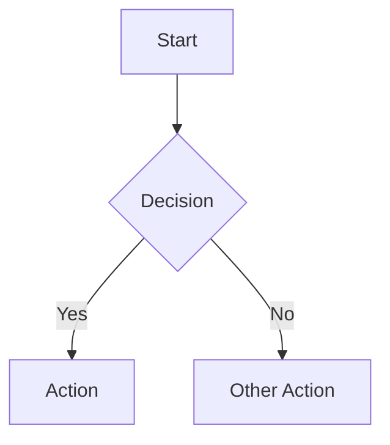

# Documentation Maintenance

This document describes how to maintain the documentation for NuciAPI.Middleware.

## Documentation Structure

```
docs/
├── INDEX.md                      # Master index
├── architecture.md               # Architecture overview (complements root ARCHITECTURE.md)
├── configuration.md              # Configuration guide
├── error-handling.md             # Error handling patterns
├── logging.md                    # Logging practices
├── security.md                   # Security considerations
├── concurrency-and-scheduling.md # Concurrency model
├── state-and-persistence.md      # State management
├── build-and-deployment.md       # Build and release process
├── testing.md                    # Testing strategies
├── troubleshooting.md            # Common issues and solutions
├── change-guide.md               # Versioning and migration
├── documentation-maintenance.md  # This file
├── api-reference/
│   ├── INDEX.md                  # API reference index
│   ├── nuci-api-middleware.md    # NuciApiMiddleware reference
│   └── nuci-api-header-names.md  # NuciApiHeaderNames reference
├── components/
│   ├── presentation.md           # Public API surface
│   ├── host-and-composition.md   # ASP.NET Core integration
│   └── application-services.md   # Helper method contracts
├── flows/
│   ├── middleware-invocation.md  # Pipeline execution flow
│   ├── client-ip-extraction.md   # IP extraction details
│   └── header-access.md          # Header reading details
└── (other files per specification)
```

## Maintenance Principles

### 1. Documentation as Code

- Documentation lives in the repository alongside code
- Changes to code should trigger documentation updates
- Documentation is versioned with the code

### 2. Single Source of Truth

| Information | Source of Truth | Documentation References |
|-------------|-----------------|-------------------------|
| Public API | Source code (XML docs) | API reference, components/presentation.md |
| Architecture | Source code + ARCHITECTURE.md | architecture.md, ARCHITECTURE.md |
| Configuration | Source code + examples | configuration.md |
| Error codes | Source code | error-handling.md, troubleshooting.md |
| Versioning | CHANGELOG.md + csproj | change-guide.md, build-and-deployment.md |

### 3. Update Triggers

Update documentation when:

- [ ] Adding/removing public API members
- [ ] Changing method signatures or behavior
- [ ] Adding new configuration options
- [ ] Changing error codes or messages
- [ ] Adding new dependencies
- [ ] Changing build/release process
- [ ] Fixing bugs that affect documented behavior
- [ ] Receiving user questions not answered in docs

## Writing Guidelines

### Style

- **Tone:** Technical, concise, practical
- **Perspective:** Second person ("you") for instructions, third person for reference
- **Formatting:** Markdown with consistent heading levels
- **Code:** Fenced blocks with language tags (`csharp`, `bash`, `json`, `yaml`)

### Structure

Each document should have:

1. **Title** (H1) — Clear, descriptive
2. **Overview** — What this covers, who it's for
3. **Table of Contents** (for long docs) — Auto-generated or manual
4. **Main Content** — Organized with H2/H3 headings
5. **Examples** — Practical, copy-pasteable
6. **Cross-references** — Links to related docs
7. **Source Locations** — File/line references for verification

### Code Examples

```csharp
// ✅ GOOD: Complete, compilable, uses real types
public sealed class MyMiddleware(RequestDelegate next, IHmacValidator validator) 
    : NuciApiMiddleware(next)
{
    private readonly IHmacValidator _validator = validator;
    
    public override async Task InvokeAsync(HttpContext context)
    {
        string clientId = GetHeaderValue(context.Request, NuciApiHeaderNames.ClientId);
        string hmac = GetHeaderValue(context.Request, NuciApiHeaderNames.HmacToken);
        
        if (!_validator.Validate(clientId, hmac, context.Request))
        {
            context.Response.StatusCode = 401;
            return;
        }
        
        await Next(context);
    }
}
```

```csharp
// ❌ BAD: Fragmented, pseudocode, missing context
// Validate HMAC
if (!Validate(clientId, hmac)) return 401;
await Next(context);
```

### Diagrams

Use Mermaid for diagrams:



Render in GitHub and VS Code automatically.

## Review Process

### For Code Changes

1. Author updates relevant docs in same PR
2. Reviewer checks:
   - [ ] Public API changes reflected in api-reference/
   - [ ] Behavior changes reflected in flows/ or components/
   - [ ] New configuration documented in configuration.md
   - [ ] Breaking changes noted in change-guide.md
   - [ ] Examples compile and run

### For Documentation-Only Changes

1. PR with documentation updates
2. Reviewer checks:
   - [ ] Accuracy against current code
   - [ ] Consistency with other docs
   - [ ] Links work (relative paths)
   - [ ] Mermaid diagrams render

## Automation

### Validate Links

```bash
# Check for broken internal links
# (Add to CI if needed)
markdown-link-check docs/**/*.md
```

### Validate Code Examples

```bash
# Extract and compile code examples (advanced)
# For now: manual verification during review
```

### Spell Check

```bash
# cspell (add to CI)
npx cspell "docs/**/*.md"
```

## Versioning Documentation

### With Code Releases

- Documentation version matches package version
- `docs/` at tag `v1.2.0` documents version 1.2.0
- No separate documentation versioning

### For Pre-releases

- Preview docs deployed with preview packages
- Mark clearly: "Documentation for v1.2.0-preview.1"

## Common Tasks

### Adding a New Public API Member

1. Add XML documentation to source
2. Update `docs/api-reference/nuci-api-middleware.md` or `nuci-api-header-names.md`
3. Update `docs/api-reference/INDEX.md`
4. Update `docs/components/presentation.md` if new type/member
5. Add example to relevant flow/component doc

### Changing Behavior

1. Update source code
2. Update affected flow documents (flows/)
3. Update component documents (components/)
4. Update troubleshooting.md if error behavior changed
5. Add entry to CHANGELOG.md
6. Update change-guide.md if breaking

### Adding Configuration

1. Update configuration.md
2. Update build-and-deployment.md if build-related
3. Update security.md if security-related
4. Add example to quick-start.md (if exists)

## Tools

| Tool | Purpose |
|------|---------|
| VS Code + Markdown Preview | Writing/editing |
| Mermaid Live Editor | Diagram prototyping |
| markdown-link-check | Link validation |
| cspell | Spell checking |
| dotnet doc | Generate API docs from XML (future) |

## Metrics

Track documentation health:

- [ ] All public API members documented
- [ ] No broken internal links
- [ ] All code examples compile
- [ ] Diagrams render correctly
- [ ] Last updated date current

## Related Documents

- [Architecture](architecture.md) — Documentation architecture
- [Repository Structure](repository-structure.md) — File organization
- [Build and Deployment](build-and-deployment.md) — Release process
- [Change Guide](change-guide.md) — Versioning policy