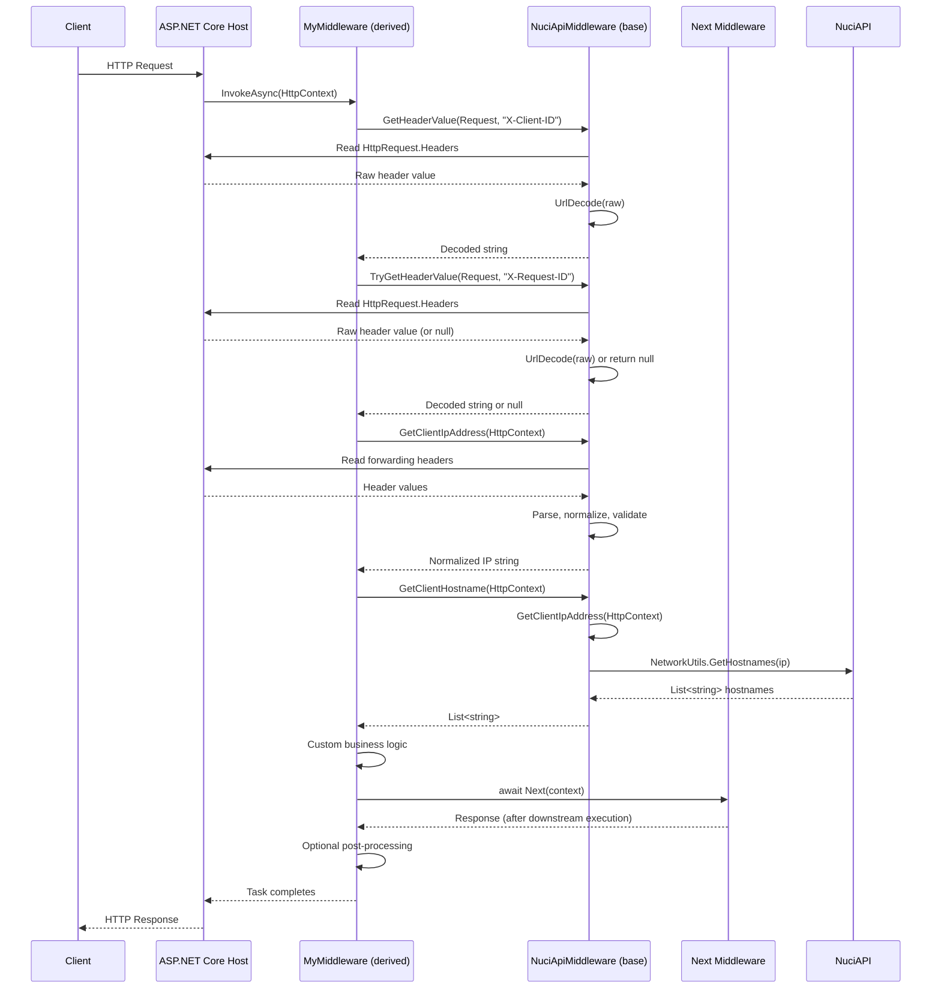

# Middleware Invocation Flow

This document traces the complete execution flow when a derived middleware is invoked in the ASP.NET Core request pipeline.

## Entry Point

```
ASP.NET Core Request Pipeline
         │
         ▼
app.UseMiddleware<MyMiddleware>()
         │
         ▼
ASP.NET Core instantiates MyMiddleware(RequestDelegate next)
         │
         ▼
MyMiddleware constructor → base(RequestDelegate next)
         │
         ▼
NuciApiMiddleware constructor:
    Next = next ?? throw ArgumentNullException
         │
         ▼
Request arrives → ASP.NET Core calls MyMiddleware.InvokeAsync(HttpContext)
```

## InvokeAsync Execution

```
MyMiddleware.InvokeAsync(HttpContext context)
         │
         ├─► Custom logic BEFORE Next(context)
         │       │
         │       ├─► GetHeaderValue(context.Request, NuciApiHeaderNames.ClientId)
         │       │       │
         │       │       └─► [Header Access Flow] → returns decoded string or throws
         │       │
         │       ├─► TryGetHeaderValue(context.Request, NuciApiHeaderNames.RequestId)
         │       │       │
         │       │       └─► [Header Access Flow] → returns decoded string or null
         │       │
         │       ├─► GetClientIpAddress(context)
         │       │       │
         │       │       └─► [Client IP Extraction Flow] → returns normalized IP string
         │       │
         │       ├─► GetClientHostname(context)
         │       │       │
         │       │       └─► GetClientIpAddress(context) → NetworkUtils.GetHostnames(ip)
         │       │
         │       └─► Custom business logic
         │
         ├─► await Next(context)  ◄─── Pipeline continuation
         │       │
         │       ▼
         │   Next middleware in chain executes
         │       │
         │       ▼
         │   Eventually reaches terminal middleware (controllers, etc.)
         │       │
         │       ▼
         │   Response propagates back up the chain
         │
         └─► Custom logic AFTER Next(context) (optional)
                 │
                 ▼
         Return Task (completes InvokeAsync)
```

## Sequence Diagram



## Key Implementation Locations

| Step | File | Method/Line |
|------|------|-------------|
| Middleware registration | Consumer's `Program.cs` | `app.UseMiddleware<T>()` |
| Base constructor | `NuciApiMiddleware.cs` | Line 23-26 |
| `InvokeAsync` entry | Derived middleware | Consumer implementation |
| `GetHeaderValue` | `NuciApiMiddleware.cs` | Line 43-53 |
| `TryGetHeaderValue` | `NuciApiMiddleware.cs` | Line 55-66 |
| `GetClientIpAddress` | `NuciApiMiddleware.cs` | Line 78-108 |
| `GetClientHostname` | `NuciApiMiddleware.cs` | Line 74-76 |
| `UrlDecode` | `NuciApiMiddleware.cs` | Line 110-122 |
| Pipeline continuation | Derived middleware | `await Next(context)` |

## Error Propagation

```
GetHeaderValue → BadHttpRequestException
    │
    ▼
ASP.NET Core catches → 400 Bad Request response
    │
    ▼
Pipeline SHORT-CIRCUITS (Next(context) NOT called)
    │
    ▼
Error handling middleware / developer exception page
```

```
TryGetHeaderValue → returns null (no exception)
    │
    ▼
Consumer checks for null → handles gracefully
    │
    ▼
Pipeline CONTINUES normally
```

```
GetClientIpAddress → all headers invalid
    │
    ▼
Falls back to context.Connection.RemoteIpAddress?.ToString()
    │
    ▼
Returns IP string or null (no exception)
    │
    ▼
Pipeline CONTINUES normally
```

```
GetClientHostname → NetworkUtils.GetHostnames fails
    │
    ▼
Returns empty List<string> (no exception)
    │
    ▼
Pipeline CONTINUES normally
```

## Testing the Flow

Unit tests use `TestNuciApiMiddleware` to exercise the flow without ASP.NET Core host:

```csharp
// Test setup
var middleware = new TestNuciApiMiddleware(_ => Task.CompletedTask);
var context = new DefaultHttpContext();
context.Request.Headers["X-Client-ID"] = "client-123";
context.Request.Headers["X-Forwarded-For"] = "198.51.100.10";

// Execute helpers directly
string clientId = middleware.GetHeader(context, NuciApiHeaderNames.ClientId);
string clientIp = middleware.GetClientIp(context);

// Assert
Assert.That(clientId, Is.EqualTo("client-123"));
Assert.That(clientIp, Is.EqualTo("198.51.100.10"));
```

See [testing.md](../testing.md) for full test strategy.